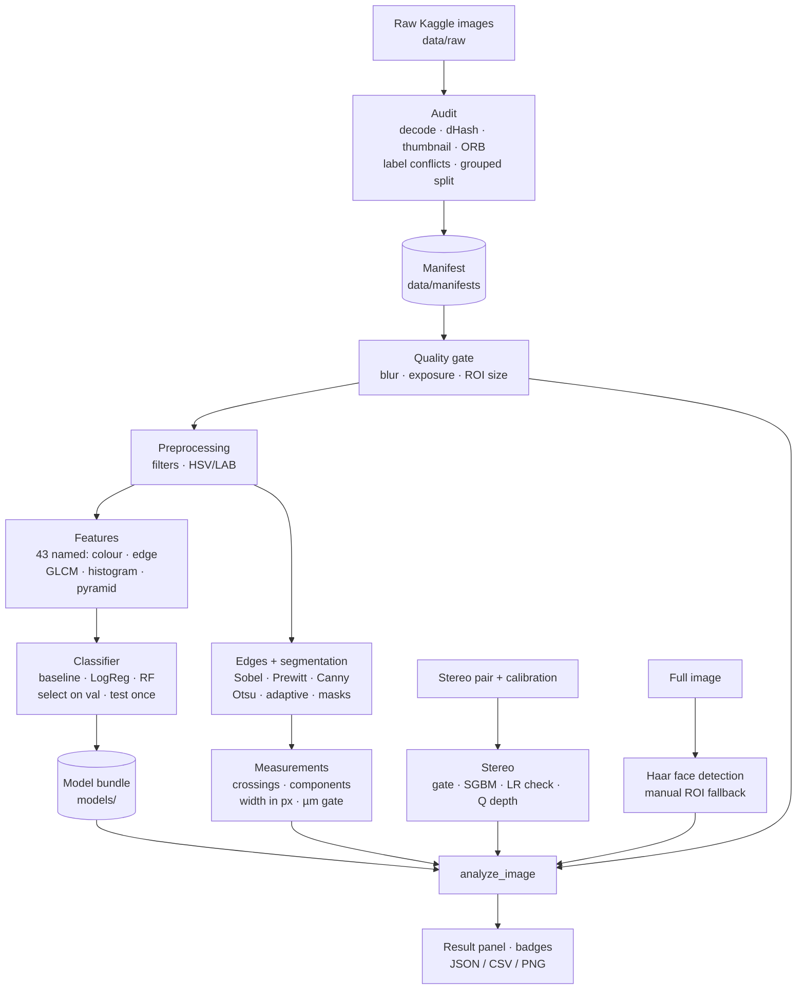

# ScalpTrack

**Explainable scalp-condition classification and experimental hair measurement with classical computer vision**

ScalpTrack is a reproducible, notebook-first computer-vision project (FCV mini-project, Labs 1–10). It
classifies scalp photographs into ten dataset-defined conditions, explains *why* with interpretable
colour, edge and texture features, and investigates hair counting, hair-shaft width and stereo depth.
Every number is labelled with what it means and how far it can be trusted.

> **Not a medical device.** Predictions are scores for the publisher's folder labels, produced by an
> experimental classifier. They are not diagnoses.

**Quick start:** see [HOW_TO_RUN.md](HOW_TO_RUN.md). **Web app:** see [Run the web app](#run-the-web-app-windows).

---

## Contents

1. [Problem statement](#1-problem-statement)
2. [Solution](#2-solution)
3. [What makes it different (USP)](#3-what-makes-it-different-usp)
4. [Results on the real dataset](#4-results-on-the-real-dataset)
5. [Architecture](#5-architecture)
6. [What happens in each notebook](#6-what-happens-in-each-notebook)
7. [Technologies](#7-technologies)
8. [Repository structure](#8-repository-structure)
9. [Limitations](#9-limitations)
10. [Team and references](#10-team-and-references)

---

## 1. Problem statement

Hair and scalp conditions such as alopecia, psoriasis, folliculitis, seborrheic dermatitis and lice are
common, and they look alike to an untrained eye. Public image datasets exist, but projects built on them
often share three problems:

* **Black-box predictions.** A deep network outputs a label, with no visible evidence for it.
* **Inflated accuracy.** Public datasets are heavily augmented. Flipped or shifted copies of one photo
  end up in both the training and the test set, so a model scores highly by memorising.
* **Unsupported measurements.** Hair "density in hairs/cm²" or "thickness in µm" gets reported from
  ordinary photos that contain no physical scale.

**Goal:** develop a reproducible computer-vision system that analyses public hair/scalp images,
predicts their dataset-defined condition labels, visualises the image-processing evidence behind each
prediction, and reports hair and 3-D measurements only in the units the data actually supports. Along
the way it applies the whole CV lab syllabus: filtering, colour spaces, edges, thresholding, texture,
pyramids, stereo and Haar detection.

## 2. Solution

ScalpTrack is a Python package (`src/scalptrack/`) and nine Jupyter notebooks (Labs 1–10). They form a
pipeline from raw images to an explained result:

1. **Audit the data first.** Every image is decoded and checked. Augmented copies are found with a
   three-stage detector (perceptual hash → thumbnail correlation → ORB geometric verification), copies
   that carry conflicting labels are excluded, and the data is re-split so that **no group of copies
   crosses train/validation/test**.
2. **Explainable features.** Classical operators (Gaussian/Laplacian filters, Sobel/Prewitt/Canny,
   HSV/LAB statistics, GLCM texture, Laplacian-pyramid energies) produce a fixed, named 43-feature
   vector.
3. **An honest classifier.** A frozen, ImageNet-pretrained MobileNetV2 turns each photo into features, and a
   linear head chosen on the **validation** set predicts the condition. The test set is scored **once**.
   The old hand-crafted-feature random forest is kept as the "before" baseline. In the app, an
   out-of-distribution gate and a confidence gate say "not recognised" or "not sure" instead of guessing.
4. **Measurements with validity gates.** Hair counts are named precisely ("reference-line crossings",
   not "hairs"). Shaft width is given in pixels; micrometres are reported only with a documented scale.
   Every algorithm is verified against synthetic images with known truth.
5. **One integrated analyzer.** `analyze_image()` takes an image and an optional region and returns
   a result panel, capability badges and JSON/CSV/PNG exports. Missing inputs give a clear status
   instead of a crash.

## 3. What makes it different (USP)

| | Typical public-dataset project | ScalpTrack |
|---|---|---|
| Data leakage | Uses the publisher's split as-is | Detects augmented copies across 12,000 images. **34% of images** sat in copy groups that crossed the publisher's split, so the data was re-split by group |
| Label quality | Trusts the folder labels | Finds the *same photo* filed under two diseases and excludes it (151 images) |
| Explainability | A label from a CNN | Named features, ablation, per-class errors and a visual technique gallery |
| Accuracy claims | Headline number | Majority baseline, a locked test set, and a memorisation check that flags residual leakage |
| Measurements | Reports µm / hairs per cm² from plain photos | Pixel units with a validity status; physical units only with a documented scale |
| 3-D | Implied from single photos | A real-data gate; stereo is shown on a calibrated synthetic scene with ground truth |
| Honest evaluation | Reports leaked accuracy | Measured that 45% of test images had a training near-copy, then built a strict split. Accuracy went from an inflated 0.95 to an honest 0.55 |
| Reproducibility | Ad-hoc notebook cells | Tested package (150+ tests), one YAML config, fixed seeds, saved model bundles, notebooks re-executable in one command |

## 4. Results on the real dataset

Dataset: Kaggle **Hair Diseases** (`sundarannamalai/hair-diseases`, v1, CC BY-NC-SA 4.0). It has 12,000
JPEGs, ten classes and 1,200 images per class. All files were verified byte-for-byte against the
publisher's listing.

### 4.1 Data audit (notebook 00)

| Check | Result |
|---|---|
| Unreadable / unlabelled files | 0 / 0 |
| Confirmed near-duplicate pairs (flip/shift/zoom copies) | 9,451, forming 1,218 copy groups |
| Copy groups crossing the publisher's train/val/test | **562 groups, 4,032 images** → publisher split rejected |
| Same photo under two different labels | 285 pairs → **151 images excluded** |
| Final split (grouped, about 70/15/15) | 11,849 usable images: train 8,240 · validation 1,811 · test 1,798 |

### 4.2 Classification: model v2 (`scripts/train_deep.py`)

**What was wrong with the first model.** The first random forest scored 0.951 test accuracy on the
audit's split, but that number was inflated by leakage. Measured with MobileNetV2 embeddings, **45% of
those test images had a near-identical copy in training** (rotated, recoloured or cropped
augmentations that the first audit did not catch). A 1-nearest-neighbour lookup scored even higher
(0.973), which shows the model was largely recognising copies.

**What v2 does differently.**

1. **Stricter leakage control.** Embedding-similar pairs (cosine ≥ 0.85) are verified as the same photo
   with ORB geometry, which handles rotation, zoom, flips and colour changes. That confirmed 104,679 more
   copy pairs. The 12,000 images reduce to only **920 independent photo groups**, so the dataset is far
   smaller than it looks.
2. **A new grouped split ("v2", about 70/15/15).** Only 0.3% of test images now have a training
   near-copy (it was 45%).
3. **A new model.** An ImageNet-pretrained **MobileNetV2** is kept frozen, with a logistic-regression
   head chosen on validation. Freezing the network avoids memorising the ~920 originals.
4. **Calibrated safety gates.** A confidence threshold and an out-of-distribution threshold are both
   calibrated on validation only.

**Before vs after, on the same strict v2 split** (test set used once, never for selection):

| Model | Test accuracy | Macro-F1 | Balanced accuracy |
|---|---|---|---|
| Majority-class baseline | ≈0.10 | — | 0.10 |
| Before: random forest on 43 hand-crafted features | 0.469 | 0.441 | 0.469 |
| **After: frozen MobileNetV2 + linear head** | **0.554** | **0.544** | **0.573** |
| After, only predictions the app shows as confident (76% of test images) | **0.637** | — | — |

Per-class test results (after):

| Condition | Precision | Recall | F1 | Test images |
|---|---|---|---|---|
| Alopecia Areata | 0.72 | 0.47 | 0.57 | 179 |
| Contact Dermatitis | 0.93 | 0.30 | 0.46 | 331 |
| Folliculitis | 0.94 | 0.49 | 0.64 | 174 |
| Head Lice | 0.75 | 0.60 | 0.67 | 319 |
| Lichen Planus | 0.41 | 0.45 | 0.43 | 189 |
| Male Pattern Baldness | 0.71 | 0.93 | 0.81 | 187 |
| Psoriasis | 0.40 | 0.63 | 0.49 | 162 |
| Seborrheic Dermatitis | 0.43 | 0.72 | 0.54 | 191 |
| Telogen Effluvium | 0.34 | 0.21 | 0.26 | 197 |
| Tinea Capitis | 0.42 | 0.92 | 0.58 | 182 |

**Is the model learning the condition, or the background?** On test images with only the central 60%
visible, accuracy is 0.48; with only the border visible, it is 0.37 (chance is 0.10). The centre carries
more signal, but the model still draws a fair amount from context: framing, lighting and dataset style.

**Out-of-distribution handling.** 11 of 11 clearly non-scalp images (scikit-image samples such as a cat,
coffee, an astronaut, plus random noise) were flagged as "not recognised". Only 1.0% of genuine test
photos were wrongly flagged.

**Per-condition match scores.** Softmax scores always add up to 100%, so a photo unlike every
condition, such as a healthy scalp, would still put most of its score on one class (often male pattern
baldness). The app therefore shows an independent match score for each condition (`deep.MatchScorer`):
the head's log-probability plus the similarity to that condition's training photos, ranked against that
condition's validation photos and scaled down by the healthy probability. A condition is reported from a
**match level of 5%**, the highest level that still reports the true condition for at least 95% of
validation photos (high recall by design).

**Healthy class.** The Kaggle data has no healthy scalps, so 9 unique healthy-scalp photos were added to
`healthy_hair/` (10 files, one byte-identical copy dropped). They are trained as an 11th class. Nine photos
are too few for a held-out split, so they are evaluated by **leave-one-out** (each photo scored by a model
trained without it). A scalp is reported as healthy when the healthy probability reaches 50%.

| Check | Result |
|---|---|
| Healthy photos called healthy (leave-one-out) | **6 / 9** (the other 3 still show a condition) |
| Highest condition score on those 6 | at most 12% |
| Test condition photos: true condition reported (recall) | **84%** (validation 95%) |
| Test condition photos wrongly called healthy | 0.05% (1 of 2,111) |
| Top match correct on test | 52% (head argmax: 55%) |
| Non-scalp probe images flagged as "not recognised" | 11 / 11 |

Nine photos is a very small sample, so the 6/9 has a wide uncertainty: the 95% Wilson interval for healthy recall is about 35–88%. More
healthy photos (ideally 100+ from different people) would make this class reliable.

Figures: `outputs/figures/model_v2/` (before/after confusion matrices, correct and incorrect test
examples). Full metrics: `outputs/results/model_v2/metrics.json`.

### 4.3 Verified algorithms (synthetic ground truth)

| Module | Result |
|---|---|
| Hair counting (separated shafts) | Exact on 100% of 29 fixtures (components and line crossings) |
| Apparent shaft width | Mean absolute error 0.31 px, max 1.0 px, over 56 width/orientation fixtures |
| Stereo depth (SGBM + calibrated Q) | Disparity error 0.20 px at 84.6% coverage; depth MAE 6.1 mm |
| GLCM texture | Matches scikit-image exactly |
| Pyramid reconstruction | Exact (error at machine precision) |

All current numbers, generated from files on disk, are in
[reports/capability_status.md](reports/capability_status.md).

## 5. Architecture



**Design principles**

* **All computation lives in the package.** Notebooks only present results, so every algorithm is unit-tested.
* **One configuration file.** `configs/default.yaml` holds every threshold, kernel, seed and path.
* **Explicit statuses.** Every output is `ok`, `exploratory`, `synthetic_demo`, `unavailable`, `failed`
  or `not_requested`. An unknown value is `null`, never `0`.
* **Real and synthetic outputs are kept apart.** They go to separate folders, and synthetic files carry
  a `SYNTHETIC_` prefix and caption.

## 6. What happens in each notebook

Run them in order. Each one starts with its objective, the labs and requirements it covers, and its
inputs, and ends with limitations and a conclusion.

| # | Notebook | Labs | What it does | Key outputs |
|---|---|---|---|---|
| 00 | `00_data_audit_basics` | 1 | Registers the sources and runs the full audit (corrupt files, sizes, duplicates, label conflicts, grouped split). Shows class distributions, sample grids and duplicate clusters. Demonstrates image reading/display, BGR vs RGB, pixel tables and resizing methods, and why measurement needs native resolution | manifest, split file, audit report, capability table |
| 01 | `01_filters_color` | 2, 4 | Mean, Gaussian, median and bilateral filters and Laplacian sharpening on the same image; MSE/PSNR against a known clean image; RGB/gray/HSV/LAB channels with their correct numeric encodings; hair vs scalp colour statistics | filter contact sheets, PSNR table, patch statistics CSV |
| 02 | `02_edges_segmentation` | 3, 5 | Sobel, Prewitt (explicit kernels) and Canny at three threshold pairs. Fixed, Otsu, adaptive-mean and adaptive-Gaussian thresholds with parameter selection; mask clean-up; hair/scalp/flake/unknown candidate masks. Measured failure cases: shadow, glare, light hair, blur | edge and threshold overlays, failure-case table |
| 03 | `03_texture_pyramids` | 6, 7 | GLCM contrast, energy, entropy, homogeneity and correlation (checked against scikit-image); histogram vs GLCM entropy; masked GLCM; feature distributions per class; Gaussian/Laplacian pyramids with exact reconstruction | feature CSV, distribution plots, pyramid figures |
| 04 | `04_hair_measurements` | — | Hair counting by connected components and reference-line crossings; shaft width by distance transform; verification on synthetic shafts, including hard cases (crossing, touching, broken, curly); flake-halo filter; robustness to blur and noise; µm gating; exploratory overlays on real images | verification CSVs, count and width overlays |
| 05 | `05_classification` | 6 (ablation) | Trains on the real dataset: label checks, grouped split, majority baseline, model selection on validation, a single locked test evaluation, per-class report, confusion matrices, texture ablation, synthetic leakage experiment, **1-NN memorisation check**, grouped cross-validation, error gallery, timing, saved model | model bundle, `metrics.json`, confusion matrices |
| 06 | `06_stereo_depth` | 8 | Real-data gate (no real stereo pairs exist). Renders a calibrated synthetic 3-D scene, then runs StereoSGBM, left-right consistency checks, Q-matrix depth and a point cloud, and evaluates against ground truth. Also shows why a shifted copy of one photo is not stereo | evaluation table, depth and point-cloud figures |
| 07 | `07_face_roi` | 9 | Loads the Haar frontal-face cascade, searches the real dataset for faces, proposes an upper-head region (always needs confirmation), and supports a manual ROI. Faces are blurred in saved figures | face-search summary, ROI overlays |
| 08 | `08_integrated_demo` | 10 | The examiner-facing application: loads the saved model, analyses a test image end to end, and shows the result panel with capability badges, a technique gallery, a robustness table and a separate synthetic stereo panel | `outputs/demo/real/*.json, *.csv, *.png` |

## Run the web app (Windows)

ScalpTrack includes a Streamlit web app (`app/`). You upload a scalp photo, or pick a sample from the
held-out test set, and the app runs the saved model and the full pipeline. It shows:

* a matched condition, "healthy-looking scalp", "no condition matched", or "photo not recognised";
* a plain-language explanation and an independent match score for every condition;
* the hair measurements (in pixels) with an overlay image;
* a general care plan (daily and weekly routine, nutrition), what to expect, and when to see a dermatologist.

The match level and the out-of-distribution threshold are calibrated on the validation split. The
healthy class comes from only 9 photos, so "healthy-looking" is a rough indication, never a check-up.

The app needs the v2 model. Run the dataset setup, `python scripts/audit_dataset.py`,
`python scripts/embed_dataset.py` and `python scripts/train_deep.py` (see [HOW_TO_RUN.md](HOW_TO_RUN.md)). Then, from the project root:

```bash
.venv\Scripts\activate
```

```bash
python -m pip install -r requirements.txt
```

```bash
python -m streamlit run app/streamlit_app.py
```

The app opens at <http://localhost:8501>. Stop it with `Ctrl+C` in the terminal.

## 7. Technologies

| Area | Tools |
|---|---|
| Language | Python 3.11–3.13 |
| Computer vision | OpenCV 4.x (filters, edges, thresholds, pyramids, ORB, StereoSGBM, Haar cascades), scikit-image (skeletons, GLCM check), SciPy, Pillow |
| Deep learning | PyTorch 2.15 + torchvision (CPU): frozen ImageNet-pretrained MobileNetV2 feature extractor |
| Machine learning | scikit-learn (Pipeline, StandardScaler, LogisticRegression, RandomForest, kNN, metrics) |
| Data and plots | NumPy, pandas, Matplotlib |
| Notebooks | Jupyter, nbformat/nbclient (headless execution), ipywidgets (optional controls) |
| Web app | Streamlit with a custom HTML/CSS design system (`app/`) |
| Quality | pytest (150+ tests), ruff (lint and format), YAML configuration, joblib model bundles |
| Optional | TensorFlow / MobileNetV2 (`requirements-training.txt`, not used for the reported results) |

## 8. Repository structure

```
ScalpTrack/
├── README.md · HOW_TO_RUN.md · requirements.txt · pyproject.toml
├── configs/default.yaml          every parameter, seed and path
├── src/scalptrack/               the package (all computation)
│   ├── io_utils · quality · preprocessing · edges · segmentation      Labs 1–5
│   ├── texture · pyramids · features                                  Labs 6–7, classifier inputs
│   ├── audit · classification · experiments · transfer                data and models
│   ├── measurements · stereo · face_roi                               hair, Lab 8, Lab 9
│   ├── pipeline · exports · viz · schema                              Lab 10 analyzer and outputs
│   └── synthetic · demo_data · config                                 fixtures and helpers
├── app/                          Streamlit web app (streamlit_app.py, engine.py, condition_info.py, assets/)
├── notebooks/00…08_*.ipynb       executed notebooks (sources in scripts/nbbuild/)
├── scripts/                      download · audit · train · run_pipeline · run/check/build notebooks · report
├── tests/                        unit and integration tests (no download needed)
├── data/  raw/ (git-ignored) · manifests/ · derived/ · synthetic/
├── models/                       saved model bundles
├── outputs/  figures/ · results/ · demo/
├── reports/capability_status.md  generated evidence summary
└── docs/                         experiment mapping · dataset setup · limitations · Member C migration
```

To read the code, start with `configs/default.yaml` and `schema.py`, then the lab modules in lab order,
then `pipeline.analyze_image`, which is written as eight numbered steps.
[docs/experiment_mapping.md](docs/experiment_mapping.md) maps every lab and requirement to code.

## 9. Limitations

* **The dataset is the bottleneck.** 12,000 images come from only about 920 independent photos (about 92
  per condition). That is too few for reliable 10-class diagnosis. The honest accuracy is about 55%
  overall, and 64% when the model is confident.
* **No real-world validation.** There is no labelled set of outside photos (other cameras, skin tones,
  clinics), so performance on Google or phone photos is unmeasured and is probably lower than the test
  numbers.
* **Some classes are weak.** Telogen effluvium (F1 0.26), lichen planus and psoriasis are often confused
  with each other.
* **Partly context-driven.** The border-only probe still scores 0.37, so lighting and framing influence
  predictions.
* **Labels are the publisher's folders**, without clinical adjudication.
* **The healthy class is tiny.** It is learned from 9 user-added photos (6/9 recognised in leave-one-out),
  so a "healthy-looking" result is a rough indication and a missed healthy scalp may still show a condition.
* **What would actually fix this:** several thousand *independent* scalp photos per condition (not
  augmentations), with dermatologist-confirmed labels, patient IDs for grouping, a healthy-scalp class, and
  an external test set from a different source. Public candidates must still be checked for these
  properties (for example the Roboflow scalp datasets linked in the spec, or DermNet-style clinical
  collections with their licences checked).
* Hair counts and widths are exploratory and in pixels; real scalp 3-D is unavailable (no stereo pairs).

The full list is in [docs/limitations.md](docs/limitations.md).

## 10. Team and references

| Member | Responsibility | Notebooks |
|---|---|---|
| Member A | Classical processing and texture | 01, 02, 03 |
| Member B | Data audit and condition classification | 00, 05 |
| Member C | Measurement, stereo, face detection, integration | 04, 06, 07, 08 |

**Dataset:** Sundar Annamalai, *Hair Diseases*, Kaggle, CC BY-NC-SA 4.0 (non-commercial, attribution
required). Images are not redistributed in this repository.
**References:** OpenCV documentation (filtering, colour conversion, thresholding, pyramids, calib3d,
cascade classifier); scikit-image GLCM; Rublee et al., *ORB: an efficient alternative to SIFT or SURF*
(ICCV 2011). The specification is the course PDF `fcv_miniProj.pdf`, which is not included in this
repository.
